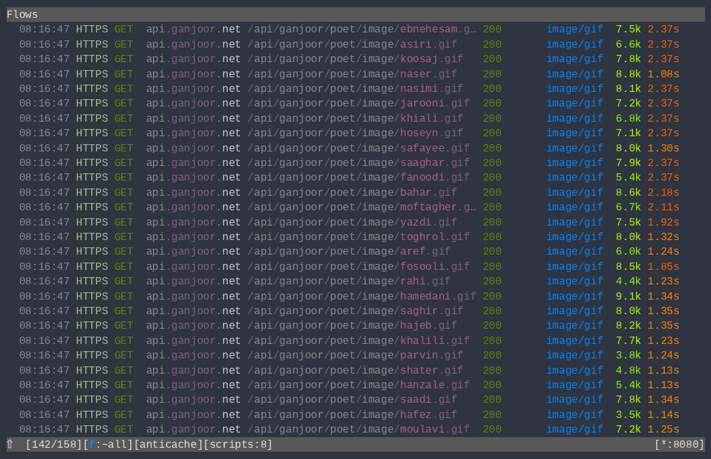

Try [mitmproxy](https://github.com/mitmproxy/mitmproxy/) as a pre-proxy or alternative to your main intercepting proxy software. you’ll thank yourself later

1. Install uv
2. Run `$ uv install` in project's root
3. set `.env` variables
4. `uv run mitmproxy -s config.py -s filter_view.py -s flow_highlighter.py -s repeater.py -s nonoise.py -s harvester.py`

Recommended Key Bindings:
```bash
$ cp .mitmproxy/keys.yaml ~/.mitmproxy
```

- `Crtl + r` to send flow to "Repeater"
- `Shift + r`/`R` to show the "Repeater"
- `Shift + h`/`H` to highlight a flow

Custom Commands:
- `:nojs` hide javascript flows
- `:noimage` hide image flows
- `:nostyle` hide style related flows
- `:repeat` send a copy of the current focused flow to repeater
- `:repeater` show repeater
- `:highlight` highlight current focused flow
- `:freeze` freeze a flow
- `:freezer` show freezed flows
- `:rotate` rotate upstream tor ip

Set scope on addon with @scope() decorator
```python
@scope()
def request(flow: http.HTTPFlow):
    ...
```

### Addons
- [Flow Highlighter](./flow_highlighter.py) — monkey-patches the flow list view to add row background colors. Commands:
  - `:highlight` — toggle red highlight on the focused flow
  - `:highlight <color>` — set highlight to a specific color
  - `:highlight list` — list available colors
  - Colors: red, orange, yellow, green, blue, pink, gray
- [Repeater](./repeater.py) like burpsuite repeater (mark flows as R and show/hide them)
- [Sampler](./harvester.py) to extract json fields, query parameters, headers from request/response flows and save to a file for later fuzzing.
- [No Noise](./nonoise.py) to drop analytic and ad related request so they dont reach the upstream proxy (BurpSuite/Caido/Zap).
- [Flow Freezer](./freezer.py) to capture and freeze a flow’s response to serve the frozen response for any future requests to the same url.
- [Rotator](./rotator.py) use Tor as upstream proxy and rotate IPs. See [Tor Setup](#tor-upstream-with-rotator) below.
- [Cache Oracle](./cache_oracle.py) detect cached responses by inspecting response headers for CDN signals (CF-Cache-Status, X-Cache, Age, max-age, custom header regex, hit/miss value patterns)
- [Full-Text Search](./fts.py) standalone ranked full-text search over captured flows using in-memory SQLite FTS5. Keeps two indexes — `unicode61` for words and `trigram` for substring/IDs — and tags matching flows so the view filters to them. Commands:
  - `:fts <query>` — search, tag matches, filter the view, log a ranked summary
  - `:fts.raw <query>` — same, with raw FTS5 syntax
  - `:fts.clear` — clear tags and remove the fts view filter
  - `:fts.status` — indexed flow count, index size, active query
- [Caller ID](./caller_id.py) attaches Chrome's request initiator (`Network.requestWillBeSent`) to proxied flows, so a request can be traced back to the JS file/line/call stack that fired it. Requires `cdp_manager.py` loaded first. Commands:
  - `:caller` — show who fired the focused flow and filter the view to flows from the same script
  - `:caller.stack` — print the full recorded call stack
  - `:caller.clear` — clear `caller` tags and remove the `caller` view filter
  - `:caller.status` — CDP capture status, tracked records, tagged flows
- [CDP Manager](./cdp_manager.py) connects to Chrome over the DevTools protocol and captures every page, iframe and service-worker script before it runs, deduplicated into content-addressed blobs under `{project_name}_data/cdp_scripts/`. Feeds `caller_id.py`, so load it first. Commands:
  - `:cdp.on` — enable script capture
  - `:cdp.off` — disable script capture
  - `:cdp.status` — connection and capture status
  - `:cdp.launch` — launch Chrome on `:9222` with the configured profile
  - `:cdp.dedupe` — re-link scripts sharing content to one blob
  - `:cdp.gc` — delete orphan blobs
- [Chains](./chains.py) records a window of flows and derives how they link — values handed from one response into a later request (JSON scalars, `Set-Cookie`, `Location` query/fragment params) plus 3xx redirects. Commands:
  - `:chains.start` / `:chains.end` — begin/stop recording and derive links
  - `:chains` — show the chain from the focused flow, or all linked groups
  - `:chains.draw` — render an interactive HTML graph to `{dir_name}_data/chains/`
  - `:chains.clear` / `:chains.wipe` — remove the view filter / wipe the window
- [OAuth Marker](./oauth_marker.py) detects OAuth2/OIDC parameters and tracks seed values (`code`, `state`, `nonce`, tokens) across a 50-request window, marking and highlighting the flows involved. Commands:
  - `:oauth` — filter the view to OAuth-marked flows
  - `:oauth.clear` — clear marks and the OAuth view filter
  - `:oauth.status` — marked flow count, tracked values, window, filter state


## Tor upstream with Rotator

Add `-s rotator.py` to the mitmproxy command. It requires a Tor daemon configured with an HTTP tunnel port and a control port.

### 1. Configure torrc

```
ControlPort 9051
HashedControlPassword <your-hashed-password>
HTTPTunnelPort 9080
```

Generate `HashedControlPassword` with: `tor --hash-password <your-password>`

### 2. Set mitmproxy options

Via CLI `--set` flags:
```bash
uv run mitmproxy -s rotator.py --set tor_control_password=<your-password> --set tor_http_port=9080 --set requests_per_ip=1000
```

Or via the console `:set`:
```
:set tor_control_password=<your-password>
```

| Option | Default | Description |
|---|---|---|
| `tor_host` | `127.0.0.1` | Tor daemon host |
| `tor_http_port` | `9080` | Tor HTTP tunnel port |
| `tor_control_port` | `9051` | Tor control port |
| `tor_control_password` | _(empty)_ | Tor control password (required) |
| `requests_per_ip` | `100` | Requests before automatic IP rotation |
| `rotate_on_status_code` | `429` | Rotate IP on a response with this status code (e.g. rate-limited) |
